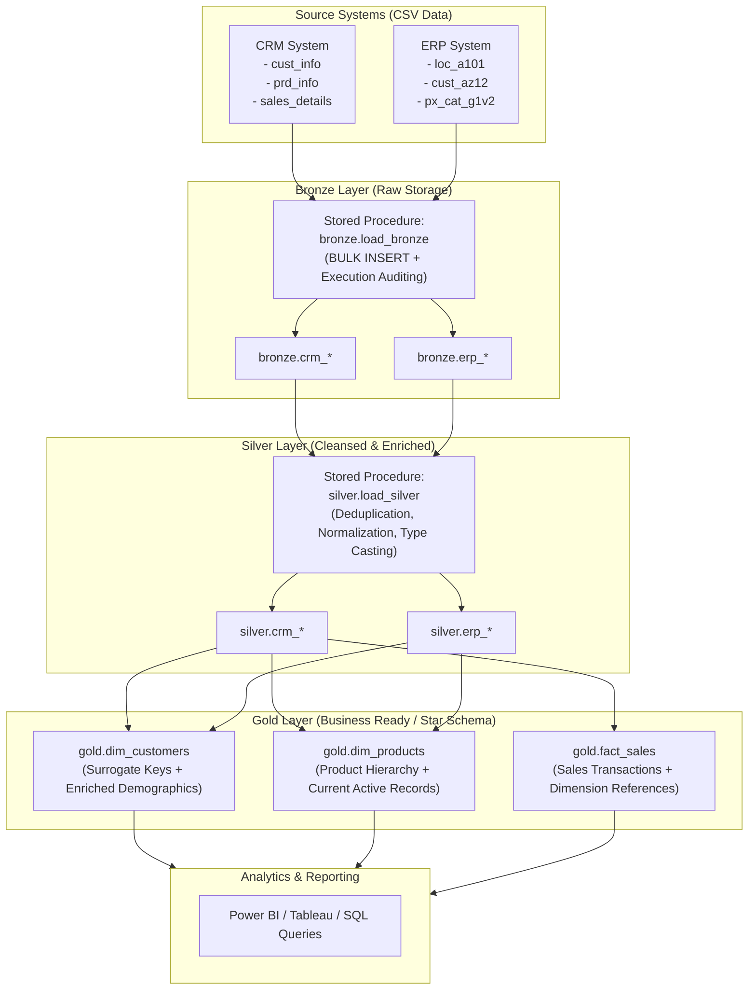
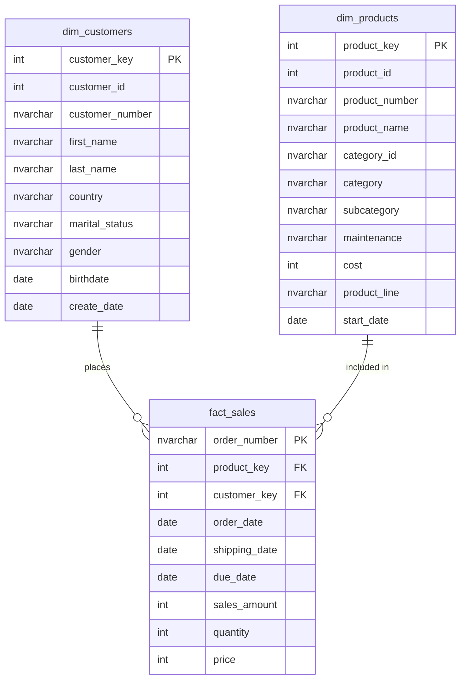

# SQL Data Warehouse Project (Medallion Architecture)

[](https://www.microsoft.com/sql-server)
[](https://learn.microsoft.com/sql/t-sql/)
[-brightgreen)](#medallion-architecture)
[](#gold-layer-star-schema)
[](#data-quality--testing)
[](LICENSE)

An end-to-end modern **Data Warehouse** solution designed and implemented on **Microsoft SQL Server** using the **Medallion Architecture (Bronze &rarr; Silver &rarr; Gold)**. This project ingests raw operational data from multiple disparate sources (CRM and ERP), performs data cleansing, validation, and transformations, and produces an analytics-ready **Star Schema** optimized for BI reporting and downstream analytical workloads.

---

## Table of Contents

1. [Project Overview](#project-overview)
2. [Medallion Architecture](#medallion-architecture)
3. [Data Sources](#data-sources)
4. [Data Pipeline & Layer Implementation](#data-pipeline--layer-implementation)
   - [Database Setup](#1-database-setup)
   - [Bronze Layer (Raw Ingestion)](#2-bronze-layer-raw-ingestion)
   - [Silver Layer (Cleansing & Standardization)](#3-silver-layer-cleansing--standardization)
   - [Gold Layer (Dimensional Modeling / Star Schema)](#4-gold-layer-dimensional-modeling--star-schema)
5. [Data Quality & Testing](#data-quality--testing)
6. [Project Structure](#project-structure)
7. [Getting Started & Execution Guide](#getting-started--execution-guide)
8. [Documentation Links](#documentation-links)
9. [Author & Acknowledgments](#author--acknowledgments)

---

## Project Overview

Organizations often struggle with data silos where operational systems (CRM, ERP) store customer, product, and sales data in different formats, naming schemes, and data qualities. 

This project solves this challenge by implementing an enterprise SQL Server Data Warehouse that:
- **Centralizes data** from multiple source systems into an auditable data platform.
- **Cleanses & normalizes data** (handling invalid dates, reconciling revenue metrics, standardizing categorical attributes, deduplicating records).
- **Structures data into a dimensional model (Star Schema)** to power high-performance analytical queries and business dashboards.
- **Includes rigorous data quality checks** to guarantee referential integrity and data validity.

---

## Medallion Architecture



---

## Data Sources

The data warehouse ingests data from two operational systems:

| System | File Name | Description | Key Attributes |
| :--- | :--- | :--- | :--- |
| **CRM** | `cust_info.csv` | Customer demographics & profile | Customer ID, Key, First/Last Name, Gender, Marital Status |
| **CRM** | `prd_info.csv` | Product catalog with validity dates | Product ID, Key, Name, Cost, Product Line, Start/End Date |
| **CRM** | `sales_details.csv` | Transactional sales orders | Order Number, Product Key, Customer ID, Dates, Sales, Quantity, Price |
| **ERP** | `loc_a101.csv` | Customer location mapping | Customer ID, Country Code |
| **ERP** | `cust_az12.csv` | Demographic records | Customer ID, Birthdate, Gender Code |
| **ERP** | `px_cat_g1v2.csv` | Product categories & maintenance | Category ID, Category, Subcategory, Maintenance Flag |

---

## Data Pipeline & Layer Implementation

### 1. Database Setup
- Script: [`scripts/init_database.sql`](scripts/init_database.sql)
- Creates the dedicated database `DataWarehouse` and segregates responsibilities across three logical schemas: `bronze`, `silver`, and `gold`.

### 2. Bronze Layer (Raw Ingestion)
- **DDL:** [`scripts/bronze/ddl_bronze.sql`](scripts/bronze/ddl_bronze.sql)
- **ETL Procedure:** [`scripts/bronze/proc_load_bronze.sql`](scripts/bronze/proc_load_bronze.sql)
- **Key Characteristics:**
  - Mirrors source schemas 1:1 without alteration.
  - Utilizes `BULK INSERT` with `TABLOCK` for high-throughput batch ingestion.
  - Automatically truncates target staging tables before each load.
  - Tracks and prints real-time step execution durations and batch metrics.
  - Implements structured error handling (`TRY...CATCH`) capturing error message, error number, and state.

### 3. Silver Layer (Cleansing & Standardization)
- **DDL:** [`scripts/silver/ddl_silver.sql`](scripts/silver/ddl_silver.sql)
- **ETL Procedure:** [`scripts/silver/proc_load_silver.sql`](scripts/silver/proc_load_silver.sql)
- **Transformations Applied:**
  - **Deduplication:** Uses `ROW_NUMBER() OVER (PARTITION BY cst_id ORDER BY cst_create_date DESC)` to ensure only the latest customer snapshot is ingested.
  - **Data Cleansing & Trimming:** Eliminates unwanted whitespace across text fields (`TRIM`).
  - **Categorical Normalization:**
    - Marital Status: Maps `'M'` &rarr; `'Married'`, `'S'` &rarr; `'Single'`, handles missing values with `'n/a'`.
    - Gender: Normalizes across CRM and ERP values (`'M'`, `'MALE'` &rarr; `'Male'`, `'F'`, `'FEMALE'` &rarr; `'Female'`).
    - Country Codes: Standardizes ISO & colloquial codes (`'US'`, `'USA'` &rarr; `'United States'`, `'DE'` &rarr; `'Germany'`).
  - **Product Line Expansion:** Decodes codes (`'M'` &rarr; Mountain, `'R'` &rarr; Road, `'T'` &rarr; Touring, `'S'` &rarr; Other Sales).
  - **Slowly Changing Dimension (SCD Type 2) Dates:** Calculates `prd_end_dt` dynamically via `LEAD(prd_start_dt) OVER (...) - 1`.
  - **Data Integrity Corrections:**
    - Recalculates missing or negative sales values via `sls_quantity * ABS(sls_price)`.
    - Derives missing unit prices via `sls_sales / NULLIF(sls_quantity, 0)`.
    - Converts integer-formatted dates (`YYYYMMDD`) into true SQL `DATE` types while setting invalid dates (`0` or incorrect length) to `NULL`.
  - **Audit Metadata:** Appends `dwh_create_date DATETIME2 DEFAULT GETDATE()` across all silver tables.

### 4. Gold Layer (Dimensional Modeling / Star Schema)
- **DDL:** [`scripts/gold/ddl_gold.sql`](scripts/gold/ddl_gold.sql)
- **Data Catalog:** [`docs/data_catalog.md`](docs/data_catalog.md)
- Implements a business-facing **Star Schema** structured into dimension views and a fact view:



- **`gold.dim_customers`**: Enriched customer dimension combining CRM demographics with ERP locations and birthdates.
- **`gold.dim_products`**: Product dimension with category hierarchy, filtered for current active catalog (`prd_end_dt IS NULL`).
- **`gold.fact_sales`**: Central transaction fact view joined to dimensions via surrogate keys (`customer_key`, `product_key`).

---

## Data Quality & Testing

Automated test suites ensure that data entering Silver and Gold satisfies enterprise data governance rules:

- **Silver Layer Checks:** [`tests/quality_checks_silver.sql`](tests/quality_checks_silver.sql)
  - Identifies NULL or duplicate primary keys (`cst_id`, `prd_id`).
  - Flags leading/trailing whitespace in string fields.
  - Validates categorical standardization (no unexpected gender or marital values).
  - Verifies date sequence validity (`sls_order_dt <= sls_ship_dt`, `sls_order_dt <= sls_due_dt`).
  - Confirms mathematical consistency (`sls_sales = sls_quantity * sls_price`).

- **Gold Layer Checks:** [`tests/quality_checks_gold.sql`](tests/quality_checks_gold.sql)
  - Ensures absolute uniqueness of surrogate keys (`customer_key`, `product_key`).
  - Verifies referential integrity between `fact_sales` and dimensions (zero orphan foreign keys).

---

## Project Structure

```plaintext
SQL_Data_Warehouse_Project/
│
├── .gitignore                          # Git ignore rules for SQL Server and local environments
├── README.md                           # Comprehensive project documentation
│
├── docs/                               # Architectural & governance documentation
│   ├── data_catalog.md                 # Gold layer data catalog & column dictionaries
│   └── naming_conventions.md           # DWH naming standards & design conventions
│
├── scripts/                            # Core SQL deployment and ETL scripts
│   ├── init_database.sql               # Database & schema creation (bronze, silver, gold)
│   │
│   ├── bronze/                         # Raw ingestion layer
│   │   ├── ddl_bronze.sql              # Bronze table DDL schemas
│   │   └── proc_load_bronze.sql        # Bronze BULK INSERT stored procedure
│   │
│   ├── silver/                         # Cleansing & standardization layer
│   │   ├── ddl_silver.sql              # Silver table DDL schemas
│   │   └── proc_load_silver.sql        # Silver ETL transformation stored procedure
│   │
│   └── gold/                           # Analytics & Star Schema layer
│       └── ddl_gold.sql                # Gold dimension & fact view definitions
│
└── tests/                              # Data quality assurance scripts
    ├── quality_checks_silver.sql       # Validation queries for Silver layer
    └── quality_checks_gold.sql         # Referential integrity & uniqueness tests for Gold
```

---

## Getting Started & Execution Guide

### Prerequisites
- **Database Engine:** Microsoft SQL Server (2019 or later recommended) or Azure SQL Database.
- **Client Tool:** [SQL Server Management Studio (SSMS)](https://learn.microsoft.com/sql/ssms/download-sql-server-management-studio-ssms) or [Azure Data Studio](https://learn.microsoft.com/azure-data-studio/).

### Step-by-Step Deployment

1. **Clone the Repository:**
   ```bash
   git clone https://github.com/yassiradila/SQL_Data_Warehouse_Project.git
   cd SQL_Data_Warehouse_Project
   ```

2. **Initialize Database & Schemas:**
   - Execute [`scripts/init_database.sql`](scripts/init_database.sql) to create `DataWarehouse` and the `bronze`, `silver`, and `gold` schemas.

3. **Deploy the Bronze Layer:**
   - Execute [`scripts/bronze/ddl_bronze.sql`](scripts/bronze/ddl_bronze.sql) to create raw staging tables.
   - Open [`scripts/bronze/proc_load_bronze.sql`](scripts/bronze/proc_load_bronze.sql), update the CSV file paths to your dataset directory, and create the stored procedure.
   - Run the ingestion procedure:
     ```sql
     EXEC bronze.load_bronze;
     ```

4. **Deploy the Silver Layer:**
   - Execute [`scripts/silver/ddl_silver.sql`](scripts/silver/ddl_silver.sql) to create cleansed tables.
   - Execute [`scripts/silver/proc_load_silver.sql`](scripts/silver/proc_load_silver.sql) to compile the transformation procedure.
   - Run the transformation procedure:
     ```sql
     EXEC silver.load_silver;
     ```

5. **Deploy the Gold Layer:**
   - Execute [`scripts/gold/ddl_gold.sql`](scripts/gold/ddl_gold.sql) to generate dimension and fact views.

6. **Execute Quality Checks:**
   - Run [`tests/quality_checks_silver.sql`](tests/quality_checks_silver.sql) and [`tests/quality_checks_gold.sql`](tests/quality_checks_gold.sql) to verify that all records pass quality expectations with zero discrepancies.

---

## Documentation Links

- [Data Catalog](docs/data_catalog.md): Detailed metadata, data types, and column descriptions for all Gold tables.
- [Naming Conventions](docs/naming_conventions.md): Architectural naming principles for schemas, tables, columns, and stored procedures.

---

## Author & Acknowledgments

- **Repository:** [yassiradila/SQL_Data_Warehouse_Project](https://github.com/yassiradila/SQL_Data_Warehouse_Project)
- **Author:** [Yassir Adila](https://github.com/yassiradila)
